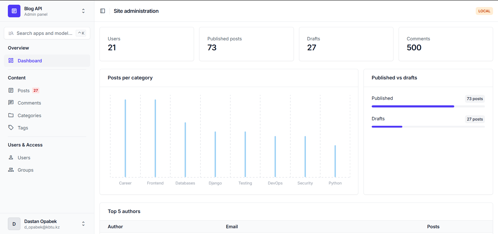
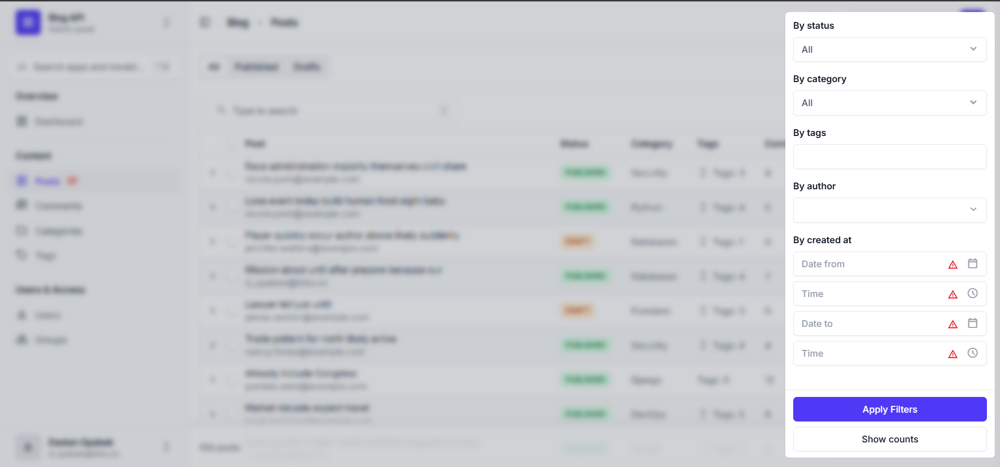
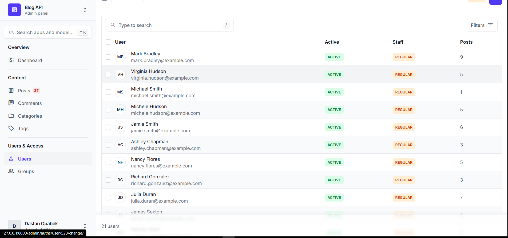

# blog-api

Blog-API for Django course.

## Quick start

```bash
python -m venv venv
venv\Scripts\activate
pip install -r requirements/dev.txt
copy settings\.env.example settings\.env
python manage.py migrate
python manage.py seed
python manage.py createsuperuser
python manage.py runserver
```

Admin: http://127.0.0.1:8000/admin/

## Seeding

`python manage.py seed` fills the database with fake users, categories, tags, posts and comments.

| Argument     | Default | Description                         |
|--------------|---------|-------------------------------------|
| `--users`    | `20`    | Number of users to create           |
| `--posts`    | `100`   | Number of posts to create           |
| `--comments` | `500`   | Number of comments to create        |
| `--clear`    | off     | Delete existing data before seeding |

- All seed users have the password `password123`.
- Running `seed` twice does not crash: existing categories and tags are skipped.
- `--clear` keeps superusers.

Example:

```
$ python manage.py seed --users 50 --posts 300 --comments 1500
Users:       50 created
Categories:   8 created
Tags:        20 created
Posts:      300 created
Comments:  1500 created
Done in 0.34 seconds
```

## Admin

The admin uses [Django Unfold](https://unfoldadmin.com/).

### Dashboard


### Posts with filters


### Post edit page
.png)

### Users
